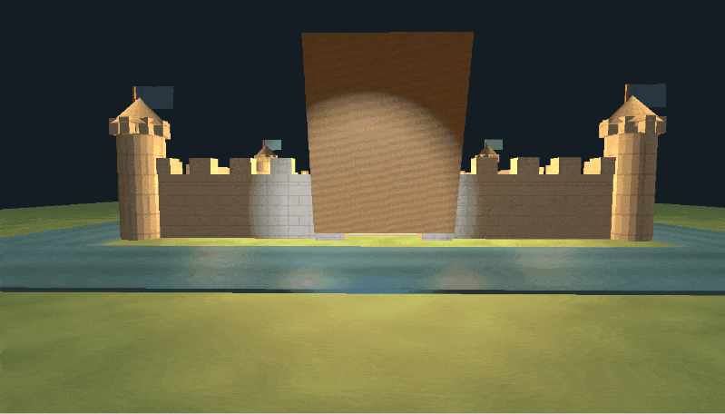

# 3D Castle Scene (OpenGL / C++)

Interactive 3D castle environment written in C++17 using OpenGL 3.3 Core Profile, GLFW, and GLEW.

The project features dynamic lighting (directional sun, 6 torch point lights, and camera-attached flashlight), custom Wavefront OBJ parsing with procedural fallbacks, custom PPM texture decoding, and real-time mesh animation.

## Demo



## Features

- **Lighting (Phong Model):**
  - Directional sunlight across the courtyard.
  - 6 point lights positioned at torches with quadratic attenuation.
  - Toggleable camera spotlight (flashlight) with smooth cone cutoffs.
- **Shaders:**
  - Vertex shader wave displacement for flag animation (`uTime` uniform).
  - Multi-light calculation and normal matrix transformations in fragment shader.
- **Asset Loading & Fallbacks:**
  - Custom token-based Wavefront `.obj` file parser.
  - Automatic fallback to procedural geometry (boxes/cylinders via `GeometryFactory`) if an OBJ asset fails to load.
  - Custom `.ppm` image loader reading raw RGB pixel buffers directly into OpenGL textures.
- **Scene & Controls:**
  - FPS camera (WASD movement, pitch/yaw mouse look, camera reset).
  - Animated drawbridge rotating around its hinge based on delta time.

## Project Structure

```text
├── assets/
│   ├── models/            # Subfolders with OBJ files
│   └── textures/          # PPM texture files
├── shaders/
│   ├── castle.vert        # Vertex transforms and flag wave animation
│   └── castle.frag        # Multi-light Phong shading
├── src/
│   ├── Camera.cpp/hpp     # View matrix and input processing
│   ├── GeometryFactory.cpp/hpp # Procedural primitive generators
│   ├── Mesh.cpp/hpp       # VAO/VBO/EBO wrappers and draw calls
│   ├── Model.cpp/hpp      # OBJ mesh loader and fallback handling
│   ├── Shader.cpp/hpp     # Shader compilation and uniform setters
│   ├── Texture.cpp/hpp    # PPM file parser
│   └── main.cpp           # Main loop, scene setup, and input handling
├── CMakeLists.txt
└── README.md
